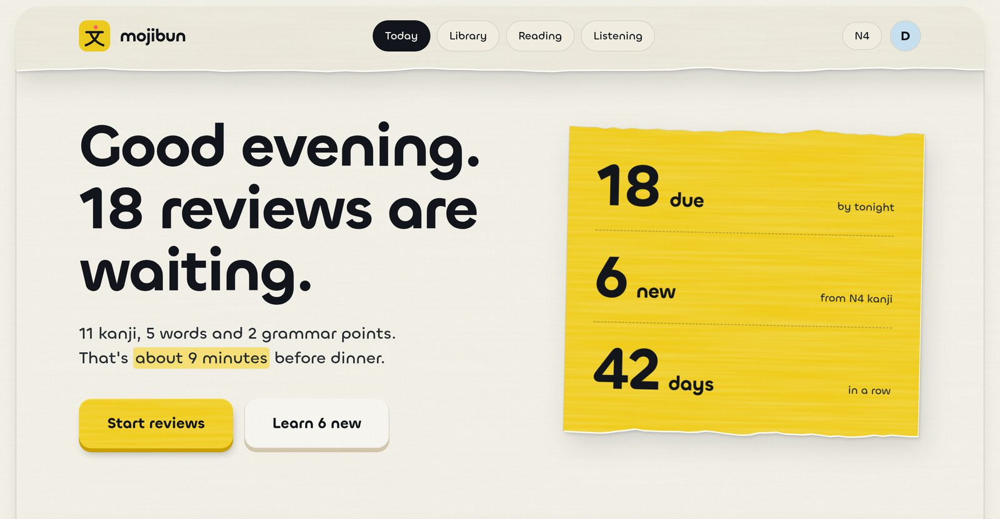

<p align="center">
  
</p>

<h1 align="center">mojibun</h1>

<p align="center">
  Learn Japanese for the JLPT, N5 to N1, one sentence at a time.
</p>

---

mojibun teaches **Kanji, Words, Grammar Points and Listening** through real example sentences. You review them on a spaced-repetition schedule (FSRS, with Anki-style New → Learning → Young → Mature stages), so things come back just before you'd forget them.

It's built to be reading-heavy and fun. Alongside reviews, mojibun gives you JLPT-style reading passages that get longer as you progress and tell a continuing story. The suggested order is a guide, not a gate: you can always start any item you're curious about.

> **Status:** early. The monorepo skeleton is in place and features are being built slice by slice. This is a side project and showcase, not a released product.

## What it will look like

<p align="center">
  
</p>

This is the Today screen from the design mock, the screen you land on when you open the app. The full mock is at [docs/design/mojibun-mock.html](docs/design/mojibun-mock.html), and the reasoning behind the Hum design is in [ADR 0011](docs/adr/0011-hum-visual-design.md).

## Run it locally

You need **Node 24+** and **Docker**.

```sh
corepack enable
pnpm install

cp .env.example .env
set -a; . ./.env; set +a      # load the env vars into your shell

docker compose up -d          # Postgres, Sudachi, VOICEVOX and Mailpit
pnpm db:migrate
pnpm dev
```

Then open:

| What        | Where                   |
| ----------- | ----------------------- |
| Web app     | http://localhost:5173   |
| API         | http://localhost:3000   |
| Mail inbox  | http://localhost:8025   |

The background worker starts with `pnpm dev` too.

## Everyday commands

| Command          | What it does                                                        |
| ---------------- | ------------------------------------------------------------------- |
| `pnpm test`      | Runs every test. Database tests use in-process PGlite, so no Docker. |
| `pnpm typecheck` | Type-checks the whole repo.                                         |
| `pnpm e2e`       | Runs the Playwright end-to-end tests.                               |
| `pnpm depcruise` | Checks that nothing breaks the import rules between packages.       |

## How the code is organised

mojibun is a modular monolith: a small **core** with **feature slices** on top.

```
apps/       web (Vite + React), api (Hono), worker (pg-boss jobs). Shells only.
core/       the shared domain: content graph, progress, learning path, learner
platform/   plumbing: db, jobs, auth, mail, ui, nlp, tts, llm
slices/     one folder per feature: learn, reviews, cram, ...
```

Each slice is self-contained and never imports another slice. To add one, create `slices/<name>/` with a `register.ts`; the apps pick it up automatically. The full rules are in [docs/architecture.md](docs/architecture.md).

## Further reading

- [CONTEXT.md](CONTEXT.md): the glossary. What a Study Item, Example or Track means here.
- [docs/architecture.md](docs/architecture.md): slices, core modules and the dependency rules CI enforces.
- [docs/adr/](docs/adr/): the decisions and why they were made.
- [docs/build-plan.md](docs/build-plan.md): what's being built, and in what order.
- [docs/licensing.md](docs/licensing.md): where content comes from and how it's attributed.

## Contributing

Most of mojibun is built by AI agents working in parallel, one issue per slice. If you're one of them, start with [CLAUDE.md](CLAUDE.md).
