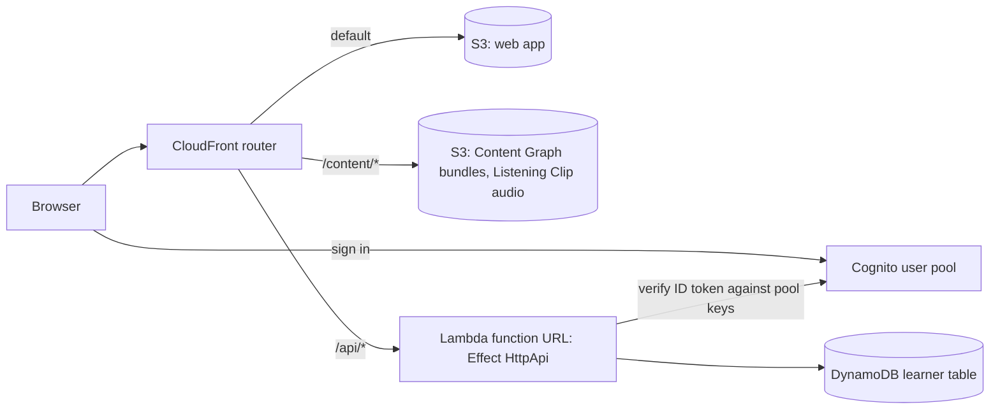

# Infrastructure

This document describes the AWS architecture for mojibun and how to run it on your machine. The infrastructure is defined in TypeScript with [Alchemy](https://alchemy.run) v2 and [Effect](https://effect.website). `alchemy dev` runs the whole stack locally on Alchemy's built-in AWS emulator, a fork of [Floci](https://github.com/floci-io/floci) in Docker. You don't need an AWS account. The decisions behind this design are recorded in these ADRs:

- [0001](adr/0001-serverless-aws-with-alchemy-and-effect.md): serverless AWS stack, defined with Alchemy and Effect
- [0002](adr/0002-content-as-static-bundles-learner-state-in-dynamodb.md): content as static bundles, Learner state in DynamoDB
- [0003](adr/0003-verify-tokens-in-the-api-function.md): token verification in the API function

**Status (2026-11-04).** The stack is a prototype. It runs end to end under `alchemy dev` and has never been deployed to AWS. The API stores Reviews and Known flags. It does not calculate Mastery yet.

## Architecture



The browser talks to one CloudFront host, so the app, the content and the API share an origin and need no CORS setup.

| Concern | Alchemy resource | Notes |
| --- | --- | --- |
| Front door | `AWS.Website.Router` | One CloudFront distribution. A CloudFront Function picks the origin for each path, using routes stored in a KeyValueStore. |
| Web app | `AWS.Website.StaticSite` | Uploads `web/` and mounts it at the router root. |
| Content Graph | `AWS.S3.Bucket` `Content` | Prebuilt JSON bundles and Listening Clip audio. Read-only at runtime. See ADR 0002. |
| Learners | `AWS.Cognito.UserPool` + `UserPoolClient` | Email sign-in on the Lite tier. Declared once in `src/auth/LearnerPool.ts`. |
| API | `AWS.Lambda.Function` `ApiFunction` | Node.js, with a public function URL behind the router. Effect `HttpApi` defines and validates the routes. |
| Learner state | `AWS.DynamoDB.Table` `LearnerTable` | On-demand billing with point-in-time recovery. Declared next to the code that uses it in `src/api/LearnerStore.ts`. |

## Code layout

```
alchemy.run.ts            the stack: Cognito, API function, content bucket, router, web app
src/api/LearnerApi.ts     HTTP API contract (Effect HttpApi + Schema)
src/api/ApiFunction.ts    the Lambda: route handlers
src/api/LearnerStore.ts   LearnerStore service and its DynamoDB layer, which owns the table
src/auth/LearnerPool.ts   Cognito pool and app client, shared by the stack and the function
src/auth/LearnerAuth.ts   LearnerAuth service: verifies Cognito ID tokens
web/index.html            placeholder app shell
scripts/smoke-local.ts    end-to-end check against `npm run dev`
scripts/cost-model.mjs    monthly cost estimate
```

Resources are declared where they are used. Alchemy turns each binding into the matching IAM permission and environment variable. For example, `DynamoDB.Query(table)` in `LearnerStore` grants the function `dynamodb:Query` on that one table.

## Routes

| Route | Auth | Purpose |
| --- | --- | --- |
| `GET /api/health` | none | Liveness check. |
| `GET /api/me/items` | ID token | Lists the Learner's Study Item state. |
| `PUT /api/me/items/:kind/:id` | ID token | Sets the Known flag. Body: `{ "known": boolean }`. |
| `POST /api/me/reviews` | ID token | Records a Review. Body: `{ "kind", "id", "grade": 0..3 }`. |

`kind` is one of `kanji`, `word`, `grammar` or `listening`. A request with a missing, forged or expired token gets a 401. A body that fails the schema gets a 400.

## Learner state data model

There is one table, keyed by `pk` and `sk`. All of a Learner's data sits under a single partition key, so every read the app needs is one `Query`.

| `pk` | `sk` | Attributes | Meaning |
| --- | --- | --- | --- |
| `LEARNER#<sub>` | `ITEM#<kind>#<id>` | `known`, `reviewCount`, `lastGrade`, `lastReviewedAt` | The Learner's state for one Study Item. |
| `LEARNER#<sub>` | `REVIEW#<iso time>#<kind>#<id>` | `grade` | One Review. Append-only. |

Recording a Review writes the `REVIEW#` row and updates the `ITEM#` row in one transaction. The Review rows are the source of truth for Mastery. The `ITEM#` row is a cached summary. Because the full history is kept, you can recompute every Learner's Mastery when the scoring rules change. Known is a separate attribute that the Learner sets directly. It never comes from Reviews.

## Run it locally

Prerequisites: Node.js 24.11.1 or later, and Docker running.

```sh
npm install
npm run dev      # deploys to the local emulator and watches for changes
npm run smoke    # in a second terminal: end-to-end check
```

`npm run dev` prints the stack outputs. The router is at `http://localhost:9500`. The emulator listens on `http://localhost:4566` and accepts any credentials.

The smoke test reads the outputs from `.alchemy/state/mojibun/dev_<user>/`. It checks these behaviors:

- The public route answers.
- Requests with no token or a forged token are rejected.
- A new Learner can sign in and record a Review.
- Marking a Word as Known works.
- A Review that fails the schema is rejected.
- The Learner's state reads back correctly.
- The router serves the app shell and a content bundle.

The script exits non-zero on any failure. `npm run typecheck` runs the TypeScript compiler.

### Local emulator notes

These were measured against Alchemy 2.0.0-beta.85, which pins the emulator image `ghcr.io/alchemy-run/floci:2.1.0-alchemy.3`, on 2026-11-04.

- **API Gateway JWT authorizers do not work locally.** The emulator's Cognito signs tokens with the real AWS issuer URL. Its API Gateway then fetches that issuer's signing keys from real AWS, where the local pool does not exist, and rejects every token. This is why the API function verifies tokens itself. See ADR 0003.
- **Upstream Floci cannot run this stack.** Upstream Floci 2.4.0 can verify the JWT if it runs in TLS mode, but it does not implement the CloudFront KeyValueStore API that `Website.Router` needs. Planning fails with `Could not parse HTML error response`.
- **The local CloudFront cannot reach `*.lambda-url.*.localhost` origins.** It refuses them as private addresses. In dev, the stack therefore routes `/api/*` to `http://localhost:4566/lambda-url/<id>/`, the emulator's path-style URL for the same function. The `<id>` is derived from the function name, which is why `ApiFunction` has a fixed name per stage. On AWS the router uses the real function URL. If a newer emulator changes how that id is derived, the smoke test fails on its first check.
- **Alchemy's default password policy requires upper case, lower case, digits and symbols.** The stack only sets `minimumLength`, so the defaults apply.
- **Windows.** Use the npm scripts or Node. The smoke test is TypeScript run by Node, so Japanese text does not pass through a shell.

## Deploying to AWS

This is not planned yet. Before the first `alchemy deploy`:

1. Add AWS credentials with `alchemy profile edit --add AWS`.
2. Switch `state: Alchemy.localState()` to `AWS.state()` so the deployed state lives in your AWS account.
3. Add a custom domain to the router, and set the Cognito client's callback URLs once the app has a login page.
4. Run `alchemy plan` and read the output before you deploy.

## Cost

Every service in the stack bills per request, per GB or per active user. Nothing bills per hour, because there is no API Gateway, load balancer, NAT gateway or database instance. With no Learners, the bill is a few cents a month for S3 storage.

`scripts/cost-model.mjs` estimates the monthly bill. It uses eu-central-1 list prices from the AWS Price List API (fetched 2026-11-04) and only the always-free allowances. The model assumes a heavy Learner: 20 study days a month, 100 Reviews a day, and one API call per Review.

| Active Learners | Estimated monthly cost |
| --- | --- |
| 10 | $0.09 |
| 100 | $0.75 |
| 1,000 | $8.05 |
| 10,000 | $106 |
| 50,000 | $857 |

Run `node scripts/cost-model.mjs 250 5000` to price other sizes, and edit the `learner` object to change the usage assumptions.

- **DynamoDB writes are the largest cost.** Each Review is a two-item transaction, and a transactional write costs twice as much as a plain one. That comes to 4 write units per Review.
- **CloudFront is second at scale.** This includes the router's CloudFront Function and KeyValueStore reads on every request.
- **Cognito is free up to 10,000 monthly active users.** Beyond that, the Lite tier costs $0.0055 per user.

Ways to lower the cost, none of them applied yet:

- Send a study session's Reviews in one batched request.
- Write the Review row and the Study Item summary without a transaction. This halves the write units, but the two rows can briefly disagree.

## Not built yet

- **Content Approval pipeline.** Generated content will land in a staging area, pass Content Approval, and then be published into the content bundles.
- **Content build.** A script that turns the source datasets into the bundles under `content/`. It will record Provenance.
- **Mastery.** Scoring Reviews into Mastery belongs to the Learning Path work.
- **CI.** `npm run dev` plus `npm run smoke` could run in a pipeline with Docker.
